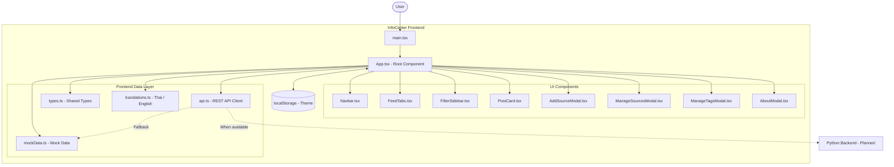

# InfoCenter Component Diagram

## Component Diagram - InfoCenter Architecture

## Diagram Description

This diagram illustrates the overall architecture of InfoCenter, including its frontend components, data layer, local storage, and planned Python backend. It shows how the main application connects with different components to provide the platform's features.
