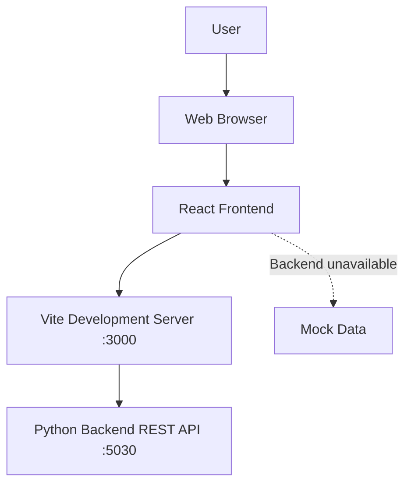

# InfoCenter UML Deployment Diagram

## 1. Deployment Diagram

This diagram illustrates the deployment architecture
of the InfoCenter application.

## 2. Description

- User: Accesses the application.
- Web Browser: Runs the frontend.
- React Frontend: Displays the user interface.
- Vite Server: Serves the frontend application.
- Python Backend: Provides REST API services.
- Mock Data: Provides fallback sample data.
