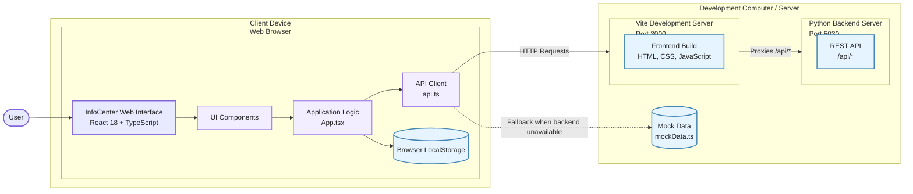

# InfoCenter - UML Deployment Diagram

## 1. Deployment Diagram

This diagram illustrates the deployment architecture of the InfoCenter application, including the client device, frontend application, development server, and backend services.

## 2. Description

- **User:** Accesses the InfoCenter application.
- **Client Device:** The device used to access the application.
- **Web Browser:** Runs the frontend application.
- **React Frontend:** Displays the user interface.
- **UI Components:** Displays individual interface elements.
- **Application Logic:** Handles application operations through App.tsx.
- **API Client:** Communicates with backend services through api.ts.
- **Browser LocalStorage:** Saves user preferences.
- **Vite Development Server:** Serves the frontend on port 3000.
- **Python Backend Server:** Provides REST API services on port 5030.
- **Mock Data:** Provides fallback data when the backend is unavailable.
