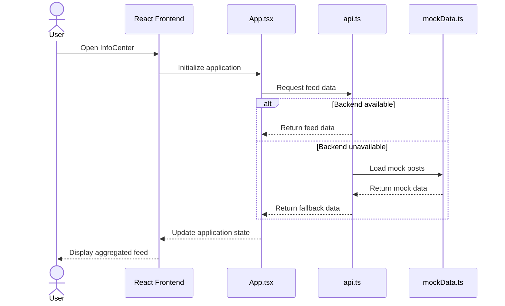
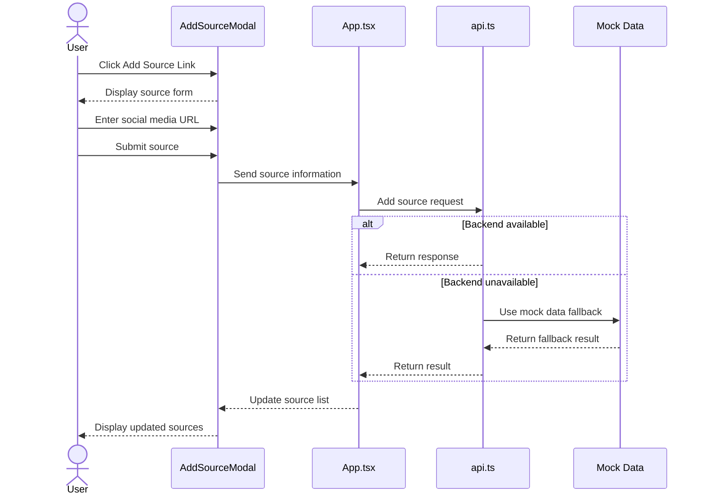
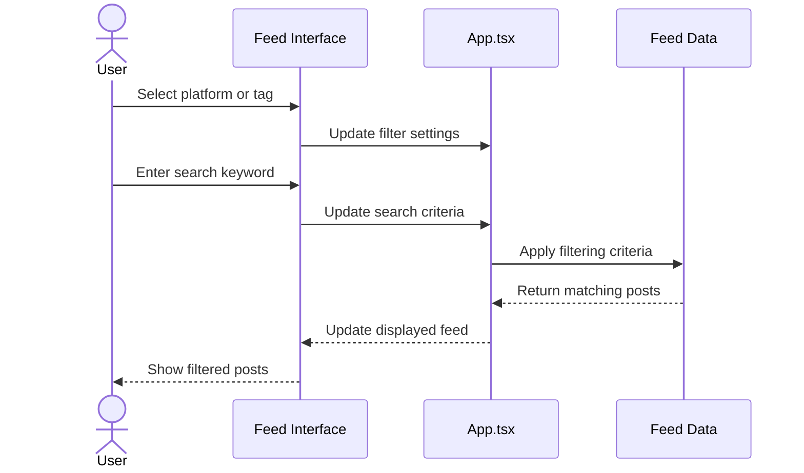

# InfoCenter Sequence Diagrams

## 1. Sequence Diagram - Load Feed

## 2. Sequence Diagram - Add a Source

## 3. Sequence Diagram - Filter and Search Posts

## Diagram Summary

These sequence diagrams illustrate how users interact with InfoCenter. They cover loading the feed, adding social media sources, and filtering or searching posts.
