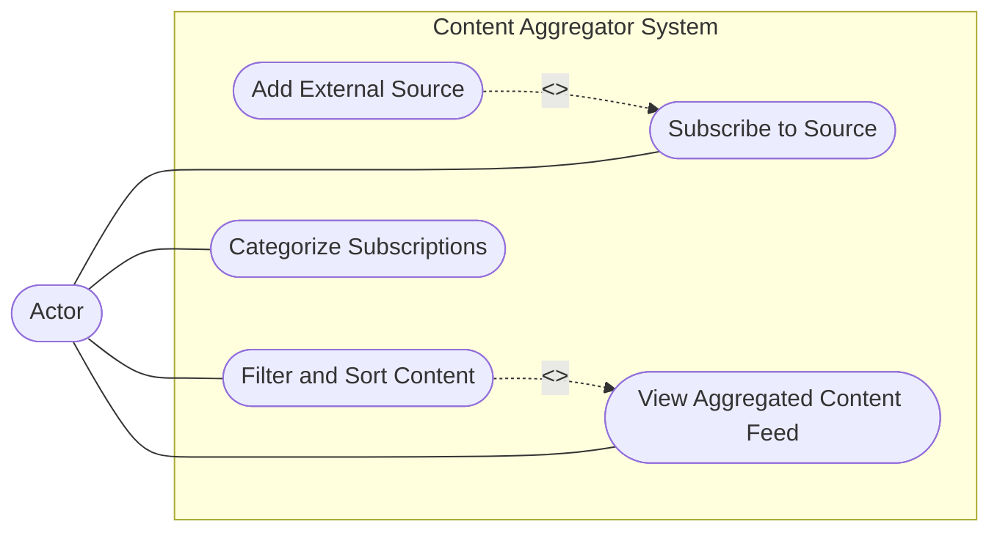

[INFOCENTERUseCaseDiagram.md](https://github.com/user-attachments/files/34875046/INFOCENTERUseCaseDiagram.md)
# Content Aggregator System – Use Case Diagram

## Overview

This use case diagram describes the main interactions between an **Actor** and the **Content Aggregator System**.

## Actor

- **Actor** – Interacts with the system to manage content sources, view the aggregated content feed, filter and sort content, and categorize subscriptions.

## Use Cases

1. **Add External Source** – Add an external content source.
2. **Subscribe to Source** – Subscribe to a content source.
3. **View Aggregated Content Feed** – View content collected from subscribed sources.
4. **Filter and Sort Content** – Filter and sort items in the aggregated content feed.
5. **Categorize Subscriptions** – Organize subscriptions into categories.

## Relationships

- **Add External Source** `<<include>>` **Subscribe to Source**
- **Filter and Sort Content** `<<extend>>` **View Aggregated Content Feed**
- The **Actor** is associated with:
  - Subscribe to Source
  - View Aggregated Content Feed
  - Filter and Sort Content
  - Categorize Subscriptions

## Diagram

---

*Converted from `INFOCENTERUseCaseDiagram.drawio.pdf`.*
