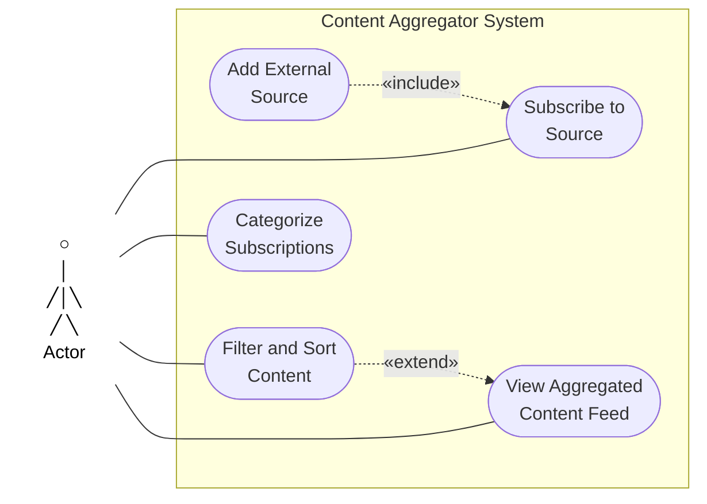

[INFOCENTERUseCaseDiagram_GitHub.md](https://github.com/user-attachments/files/34875057/INFOCENTERUseCaseDiagram_GitHub.md)
# Content Aggregator System – Use Case Diagram

The Mermaid diagram below recreates the original use case diagram, including the system boundary, actor associations, and `<<include>>` / `<<extend>>` relationships.

