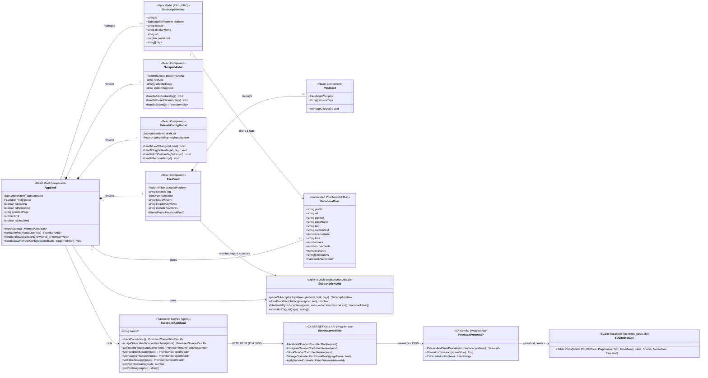

# InfoCenter — UML Class & Data Model Diagram

## 1. Class Diagram (Frontend + C# .NET Backend)

This diagram illustrates the object-oriented data models, React components, TypeScript service layer (`Frontend/src/`), and C# ASP.NET Core Web API classes (`Program.cs`) that implement **FR-1 through FR-4**.

---

## 2. Core Data Entities & Responsibilities

1. **`SubscriptionItem` (`Frontend/src/types/facebook.ts`) — FR-1 & FR-3:**
   - Represents a subscribed social media page/account across `facebook`, `instagram`, or `tiktok`.
   - Holds `postsLimit` (per-account display cap) and `tags: string[]` (custom multi-tag categories created or selected by the user).
2. **`FacebookPost` (`Frontend/src/types/facebook.ts` & `mockData.ts`) — FR-2:**
   - Unified schema normalized by `normalizeSocialPost()` from raw Facebook (`pageName`, `topLevelUrl`, `likes`), Instagram (`ownerUsername`, `shortCode`, `likesCount`), and TikTok (`authorMeta.name`, `webVideoUrl`, `diggCount`) payloads.
3. **`FacebookApiClient` (`Frontend/src/services/api.ts`) — FR-1 & FR-2:**
   - Connects to the C# .NET 8 Web API on `http://localhost:5030` (`/api/Storage/recent-posts`, `/api/FacebookScraper/run`, `/api/InstagramScraper/run`, `/api/TiktokScraper/run`) and provides automatic simulation fallback (`DEMO_MOCK_POSTS`) when running offline or inside `prototype/index.html`.
4. **`DotNetControllers` & `PostDataProcessor` (`Program.cs`) — FR-1 & FR-2:**
   - C# backend controllers that orchestrate Apify actor runs, parse heterogeneous social media JSON responses, and persist normalized records into SQLite (`facebook_posts.db`).
