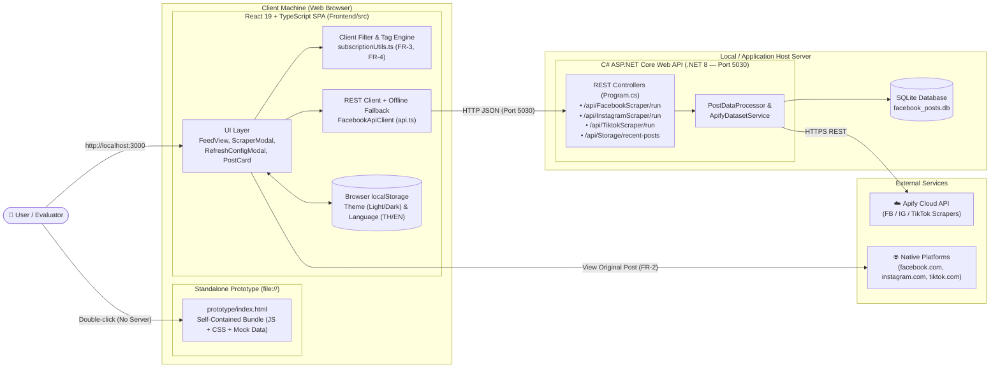

# InfoCenter — System Architecture & Deployment Diagram

## 1. Deployment & Runtime Architecture

This diagram illustrates both deployment modes supported by **InfoCenter**:
1. **Full-Stack Mode:** React 19 + Vite Frontend communicating over HTTP (`http://localhost:5030`) with the **C# ASP.NET Core (.NET 8) Backend** (`Program.cs`), SQLite (`facebook_posts.db`), and Apify Cloud Scrapers.
2. **Standalone Clickable Prototype Mode (`prototype/index.html`):** Zero-server single-file bundle opened directly via `file://` in any browser with embedded normalized FB/IG/TikTok datasets (`DEMO_MOCK_POSTS`).

---

## 2. Deployment Components Description

| Tier / Node | Artifact / File | Technology | Role in System |
| :--- | :--- | :--- | :--- |
| **Standalone Prototype** | `prototype/index.html` | Self-contained HTML5 + ES Module + Tailwind CSS | Opens directly in any browser without a server (`file://`) to verify all Must FRs (**FR-1 to FR-4**). |
| **Frontend SPA** | `Frontend/src/*` | React 19, TypeScript 5.8, Vite, Tailwind CSS | Interactive bilingual (TH/EN) dashboard with Editorial Daylight & Obsidian Slate themes. |
| **API Client & Normalizer** | `Frontend/src/services/api.ts`, `mockData.ts` | TypeScript | Connects to `http://localhost:5030`; normalizes heterogeneous FB/IG/TikTok JSON schemas; provides automatic offline simulation fallback. |
| **Backend Server** | `Program.cs`, `FacebookScraperApi.csproj` | C# ASP.NET Core (.NET 8) | Exposes scraper execution and storage query endpoints on `http://localhost:5030` with CORS enabled. |
| **Persistence Layer** | `facebook_posts.db` | Microsoft.Data.Sqlite (SQLite) | Stores scraped and normalized posts locally for fast retrieval and deduplication. |
| **External Data Provider** | Apify REST API | Cloud Actor Runs / Datasets | Executes headless social media scraping for Facebook pages, Instagram profiles, and TikTok creators. |
