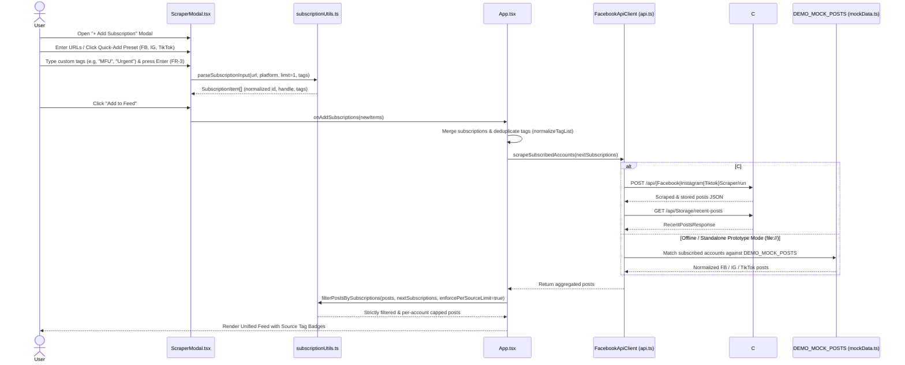
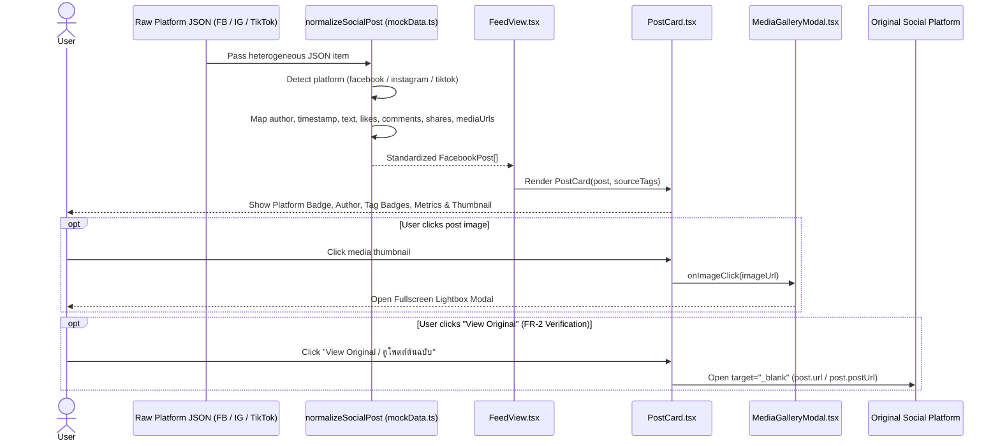
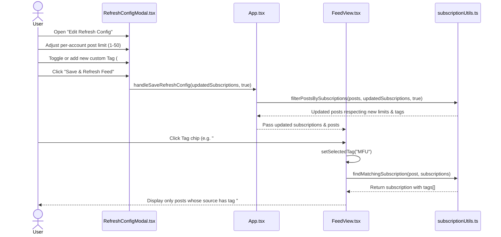
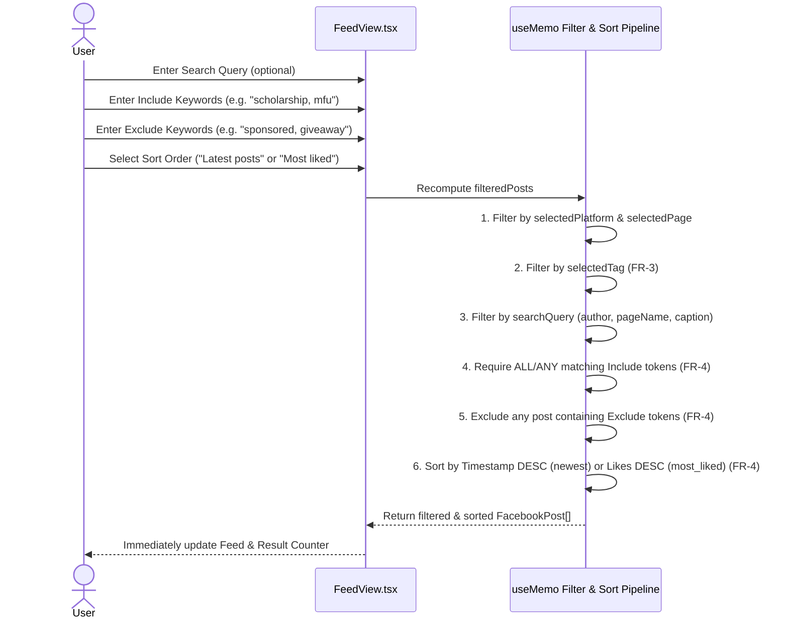

# InfoCenter — Sequence & Component Diagrams (All Must FRs)

## 1. Sequence Diagram — FR-1 & FR-3: Add Subscriptions with Custom Multi-Tags & Aggregate Posts

Covers **FR-1 (Source Subscription & Aggregation)** and **FR-3 (Custom Multi-Tagging upon Subscription)**.

---

## 2. Sequence Diagram — FR-2: Unified Feed Normalization, Media Gallery & Original Post Navigation

Covers **FR-2 (Unified Feed Display & Direct Link to Original Source)**.

---

## 3. Sequence Diagram — FR-3: Edit Subscriptions, Per-Account Limits & Filter by Custom Tag

Covers **FR-3 (Manage Multi-Tags on Existing Sources & Filter Feed by Tag)**.

---

## 4. Sequence Diagram — FR-4: Include / Exclude Keyword Filtering & Feed Sorting

Covers **FR-4 (Search, Include Keywords, Exclude Keywords, and Sort by Latest vs Most Liked)**.

---

## 5. Component Diagram — InfoCenter Architecture

```mermaid
flowchart TB
    User(["👤 User"])

    subgraph Frontend["Frontend SPA (Frontend/src) & Standalone Prototype (prototype/index.html)"]
        App["App.tsx<br/>Subscription & Feed State Orchestrator"]

        subgraph Components["UI Components (Frontend/src/components)"]
            Navbar["Navbar.tsx<br/>Brand, Theme Toggle (Light/Dark), Language Toggle (TH/EN)"]
            FeedView["FeedView.tsx<br/>Sidebar (Platforms, Tags FR-3, Followed Accounts)<br/>+ Top Filter Bar (Search, Include/Exclude, Sort FR-4)"]
            PostCard["PostCard.tsx<br/>Unified Post Layout, Tag Badges, Metrics & Original Link (FR-2)"]
            ScraperModal["ScraperModal.tsx<br/>Add URLs/Presets + Custom Multi-Tagging (FR-1, FR-3)"]
            RefreshModal["RefreshConfigModal.tsx<br/>Per-Account Post Limits, Multi-Tag Editor & Unsubscribe (FR-1, FR-3)"]
            GalleryModal["MediaGalleryModal.tsx<br/>Image Lightbox Preview"]
        end

        subgraph Services["Services & i18n Layer"]
            Api["services/api.ts<br/>FacebookApiClient (Port 5030 + Fallback)"]
            SubUtils["services/subscriptionUtils.ts<br/>URL Parser, Strict Filter & Tag Normalizer"]
            MockData["services/mockData.ts<br/>Real FB/IG/TikTok JSON Normalizer"]
            I18n["i18n/LanguageContext.tsx & strings.ts<br/>Bilingual TH / EN Dictionary"]
        end
    end

    subgraph Backend["C# ASP.NET Core Backend (Program.cs — Port 5030)"]
        FBights["FacebookScraperController<br/>POST /api/FacebookScraper/run"]
        IGCtrl["InstagramScraperController<br/>POST /api/InstagramScraper/run"]
        TTCtrl["TiktokScraperController<br/>POST /api/TiktokScraper/run"]
        StoreCtrl["StorageController<br/>GET /api/Storage/recent-posts"]
        Proc["PostDataProcessor & SQLite (facebook_posts.db)"]
    end

    User --> App
    App --> Navbar
    App --> FeedView
    FeedView --> PostCard
    App --> ScraperModal
    App --> RefreshModal
    App --> GalleryModal

    App --> Api
    App --> SubUtils
    FeedView --> SubUtils
    ScraperModal --> SubUtils
    RefreshModal --> SubUtils
    Api --> MockData
    Components --> I18n

    Api -->|"HTTP REST"| FBights
    Api -->|"HTTP REST"| IGCtrl
    Api -->|"HTTP REST"| TTCtrl
    Api -->|"HTTP REST"| StoreCtrl
    FBights --> Proc
    IGCtrl --> Proc
    TTCtrl --> Proc
    StoreCtrl --> Proc
```

