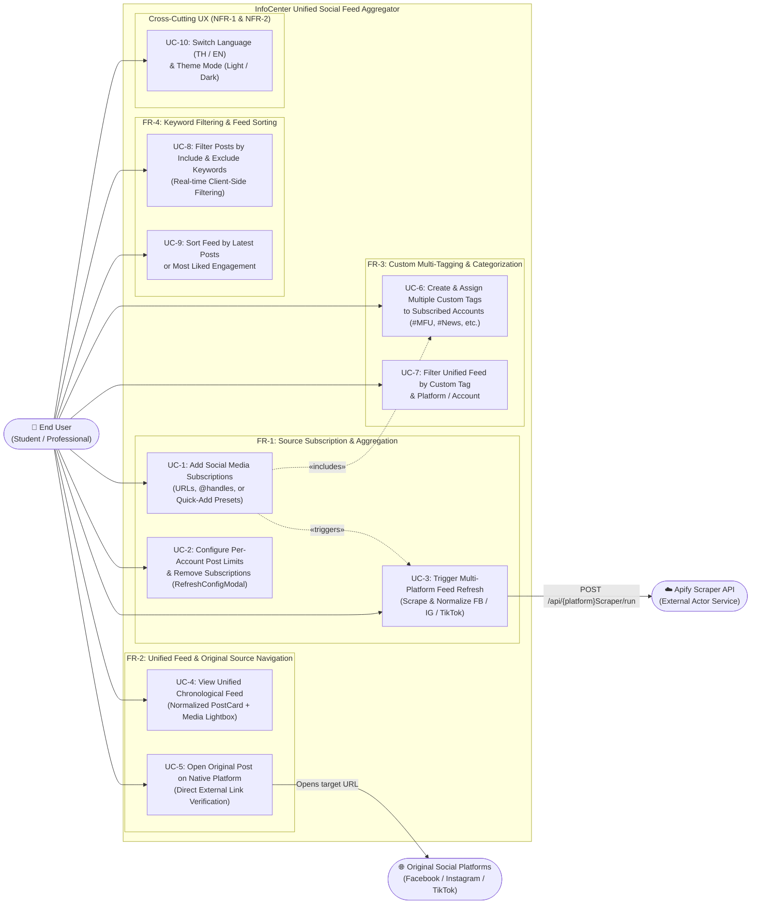

# InfoCenter — Use Case Diagram (M3 Design)

## 1. Use Case Overview

The **InfoCenter** system provides a unified, distraction-free social media aggregation dashboard for students, researchers, and digital professionals who follow updates across **Facebook**, **Instagram**, and **TikTok**. All use cases map directly to the M2 SRS **Must-Have Functional Requirements (FR-1 to FR-4)** and Non-Functional Requirements (NFR-1 to NFR-3).

---

## 2. Use Case Specifications (Mapped to Must FRs)

| Use Case ID | Use Case Name | Mapped Requirement | Primary Actor | Key UI Component / Backend Endpoint |
| :--- | :--- | :--- | :--- | :--- |
| **UC-1** | Add Social Media Subscriptions | **FR-1** (Must) | End User | `ScraperModal.tsx`, `parseSubscriptionInput()` (`subscriptionUtils.ts`) |
| **UC-2** | Configure Per-Account Post Limits & Unsubscribe | **FR-1** (Must) | End User | `RefreshConfigModal.tsx`, `App.tsx` (`handleSaveRefreshConfig`) |
| **UC-3** | Trigger Multi-Platform Feed Refresh | **FR-1**, **FR-2** (Must) | End User, Apify API | `FacebookApiClient.scrapeSubscribedAccounts()` (`api.ts`), C# Controllers (`Program.cs`) |
| **UC-4** | View Unified Feed & Media Gallery | **FR-2** (Must) | End User | `FeedView.tsx`, `PostCard.tsx`, `MediaGalleryModal.tsx` |
| **UC-5** | Navigate to Original Social Post | **FR-2** (Must) | End User | `PostCard.tsx` (`View Original` anchor link) |
| **UC-6** | Create & Assign Multiple Custom Tags | **FR-3** (Must) | End User | `ScraperModal.tsx`, `RefreshConfigModal.tsx`, `normalizeTagList()` |
| **UC-7** | Filter Feed by Custom Tag / Account / Platform | **FR-3** (Must) | End User | `FeedView.tsx` (Left Sidebar Tag Filter & Followed Accounts list) |
| **UC-8** | Filter Posts by Include / Exclude Keywords | **FR-4** (Must) | End User | `FeedView.tsx` (Top Filter Bar: Search, Include, Exclude inputs) |
| **UC-9** | Sort Feed by Newest or Most Liked | **FR-4** (Must) | End User | `FeedView.tsx` (`sortOrder`: `'newest'` \| `'most_liked'`) |
| **UC-10** | Switch Bilingual UI (TH/EN) & Theme (Light/Dark) | **NFR-1**, **NFR-2** | End User | `Navbar.tsx`, `LanguageContext.tsx`, `strings.ts` |
